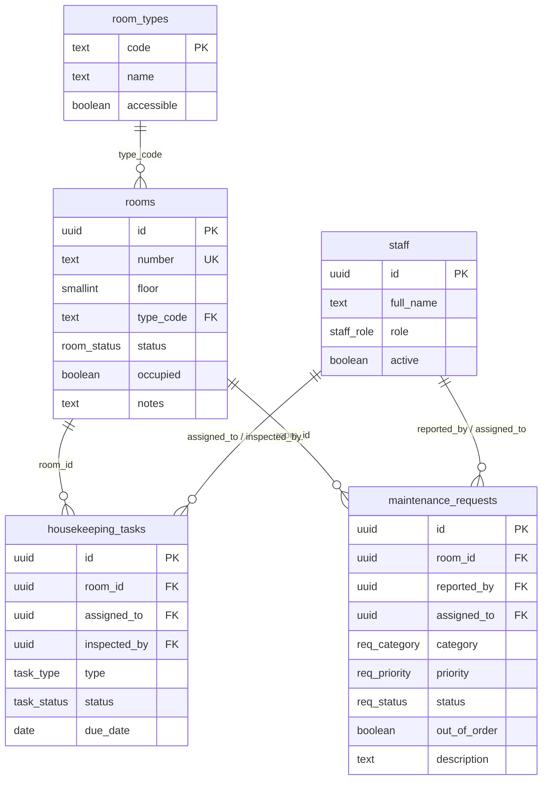

# StayDesk · app (Claude Build Challenge · Hospitality · Niveles 2 y 3)

Tablero de habitaciones, limpieza y mantenimiento para el hotel de ejemplo **StayDesk Demo Inn**.
Next.js (App Router, TypeScript) + Supabase Postgres + Vercel.

## Correr en local

```bash
cp .env.example .env.local   # y llena las claves (Supabase → Project Settings → API Keys)
npm install
npm run dev
```

## Base de datos

- Migraciones: `supabase/migrations/` (esquema, restricciones, triggers y RLS).
- Datos de ejemplo inventados: `supabase/seed.sql` (7 tipos, 173 habitaciones, 20 personas, 58 tareas, 25 reparaciones). Se puede volver a correr: borra y llena.

### Reglas que viven en la base

- Reparación abierta con `out_of_order = true` → la habitación pasa a `out_of_order`; al cerrar la última → `dirty`.
- Tarea `in_progress` → habitación `cleaning`; `done` → `inspected`; `inspected` → `ready`.
- Una tarea solo se asigna a una camarera activa; una reparación, a un ingeniero activo.
- Una sola tarea abierta por habitación y día.

### Esquema



## Seguridad

- La app consulta solo desde el servidor (`src/lib/supabase.ts`, marcado `server-only`) con `SUPABASE_SECRET_KEY`, que nunca lleva el prefijo `NEXT_PUBLIC_`.
- RLS activo en todas las tablas y sin políticas: la clave pública no puede leer ni escribir nada. En el Nivel 3 entran sesión de usuario y políticas.
- `.env*` está en `.gitignore`; en el repo solo está `.env.example` sin valores secretos.
- Validación en dos capas: zod en las acciones del servidor y restricciones en Postgres.
