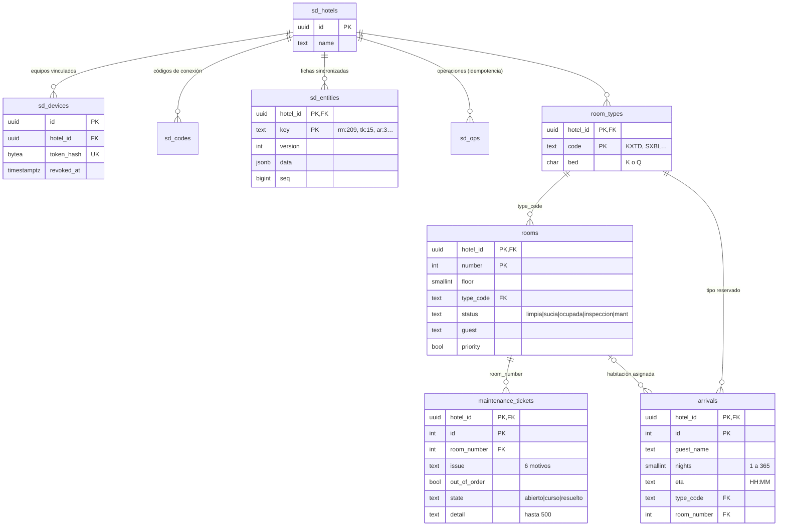

# StayDesk · Nivel 2 (Data) · Claude Build Challenge · Hospitality

**StayDesk 25.8**, la app de operación hotelera de un solo archivo, ahora guarda sus registros principales en
**Postgres (Supabase)**. Esta versión se publica en **Vercel**. La app se ve y funciona igual que siempre;
lo nuevo está en el servidor: tablas relacionadas, restricciones y validación de cada cambio.

| Qué | Dónde |
|---|---|
| App (StayDesk 25.8, kit oficial) | `deploy/` (Vercel publica esta carpeta) |
| Migraciones SQL | `supabase/migrations/` |
| Datos de ejemplo (234 registros inventados) | `supabase/seed.sql`, generado por `scripts/gen_seed.py` |
| Cómo se arma `deploy/` | `scripts/build_deploy.py` |

## Cómo funciona

1. Cada equipo (celular, PC de recepción…) se **vincula** al hotel con un enlace de invitación (`…#unirse=…`) o un
   código de 8 letras. El servidor le entrega un **token secreto de equipo**; solo se guarda su huella (SHA-256).
2. Cada 1,5 s, y enseguida después de un cambio, la app envía las fichas que cambiaron con la versión que tenía
   (`sd_push`) y recibe las que cambiaron otros equipos (`sd_pull`). Sin Internet, los cambios esperan en una
   bandeja de salida y se envían al volver. Si dos equipos cambian la misma ficha, gana la que llega primero y
   la app avisa.
3. **Nuevo en el Nivel 2:** cada ficha de habitación (`rm:`), ticket de mantenimiento (`tk:`) y llegada (`ar:`)
   se copia a tablas de verdad (`rooms`, `maintenance_tickets`, `arrivals`, `room_types`) con tipos, llaves
   foráneas y restricciones. Si la ficha no cumple las reglas, **el servidor la rechaza**: no se guarda ni llega a
   los otros equipos, aunque alguien se salte la validación del navegador. Los demás cambios del mismo lote sí se
   guardan. La app ya maneja esa respuesta: no la reintenta en bucle y lo anota en *Registro*.

### Ejemplos de lo que el servidor rechaza

| Cambio enviado | Regla |
|---|---|
| Estado de habitación `"lista"` | `rooms.status` ∈ limpia · sucia · ocupada · inspeccion · mant |
| Ticket para la habitación 999 | llave foránea `maintenance_tickets → rooms` |
| Detalle de ticket de 600 letras | `maintenance_tickets.detail` ≤ 500 |
| Llegada con 0 noches | `arrivals.nights` entre 1 y 365 |
| Hora de llegada `"25:99"` | `arrivals.eta` con formato HH:MM |
| Ficha `rm:211` que trae `id: 212` | el número de la ficha debe coincidir |
| Piso `"tres"` | debe ser un número entero |

## Esquema

## Búsqueda y filtros

En **Habitaciones**: buscador por número, filtros por estado («Vacantes limpias», «Vacantes sucias», «Ocupadas»,
«En inspección», «Mantenimiento»…) y por tipo («Todos los tipos»). Todo trabaja sobre los datos que llegan del servidor.

## Seguridad

- **No hay claves secretas en la app ni en este repo.** El navegador solo usa la clave **pública** del proyecto, que
  llega en el enlace de invitación. Con ella no se puede leer ni escribir ninguna tabla: RLS está activo en todas
  y sin políticas. Lo único que la clave pública puede hacer es llamar a 8 funciones (`sd_register`, `sd_push`,
  `sd_pull`, `sd_device_code`, `sd_devices_list`, `sd_revoke`, `sd_gc_guest`, `sd_gc_guest_send`). Todas, salvo
  las dos del chat del huésped, exigen el token secreto del equipo.
- Supabase avisa que esas 8 funciones son `SECURITY DEFINER` y públicas. Es a propósito: son la única puerta de la
  app y cada una revisa el token del equipo (o, en el chat, la habitación y el apellido del huésped alojado).
- `sd_create_hotel` (crear un hotel y su primer código) solo se puede usar desde el panel de Supabase.
- La clave secreta de Supabase (`sb_secret_…`) **no se usa** en esta versión. Nunca va en el navegador ni en el repo.
- La CSP del kit limita las conexiones al propio sitio y a los dos proyectos de Supabase de StayDesk.

## Instalar desde cero

1. Proyecto nuevo de Supabase. Corre en orden las migraciones de `supabase/migrations/` y luego `supabase/seed.sql`.
2. En el editor SQL: inserta un código de conexión para el hotel de ejemplo
   (`insert into sd_codes(code, hotel_id, expires_at) values (sd_newcode(), '5d5d0000-0000-4000-8000-000000000001', now() + interval '1 day') returning code;`).
3. Publica `deploy/` en Vercel (Framework: *Other*, sin comando de build, *Root Directory* = `deploy`).
4. En la app: entra con un usuario, abre **Sincronización**, pega la dirección del proyecto, la clave pública y el código.
   Desde ese equipo puedes crear el enlace de invitación para los demás.

## Límites honestos

- Es un prototipo de alta fidelidad para **un hotel** de Florida, probado en Chromium.
- El dinero (folios, caja) todavía no se sincroniza: es la fase 1 del servidor.
- Las migraciones `20261109000001` y `…02` se **reconstruyeron** desde la base en vivo de StayDesk 25.8 (las originales
  no estaban en el repo). El Nivel 2 se montó en un proyecto aparte (`staydesk-data`) para no tocar los equipos que ya
  usan el servidor anterior.
- El único cambio al kit 25.8 es ampliar la CSP (`connect-src`) para el proyecto nuevo (ver `scripts/build_deploy.py`).
